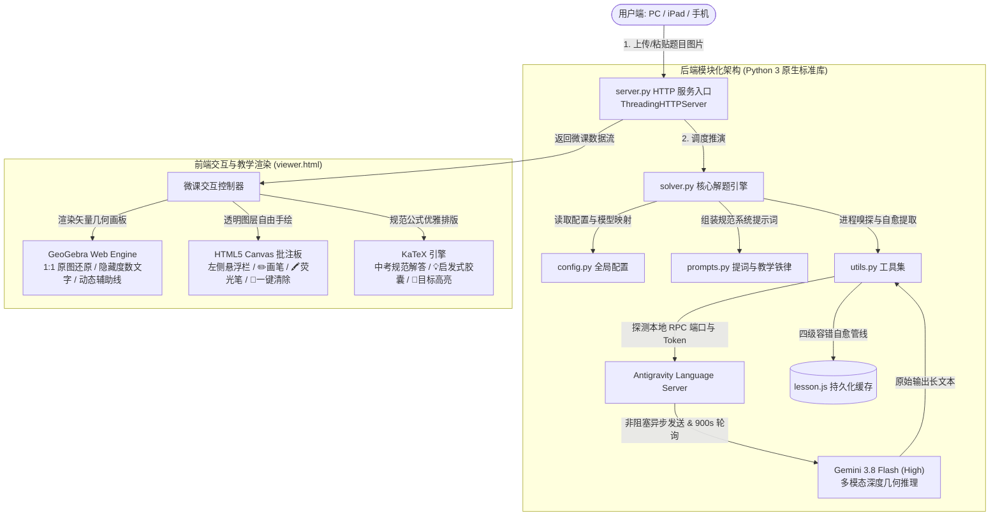

# 📐 Math Tutor - 初中几何交互微课生成器

> **基于 Antigravity 本地多模态大模型与 GeoGebra 交互画板的初中数学几何培优 AI 助教。**  
> 一键粘贴原题图片，全自动 1:1 复刻原图、启发式推导演绎、动态生成 GeoGebra 交互式板书、自由手写批注与中考规范书写过程。

---

## 🌟 核心亮点

- 📸 **真题图片一秒解析**：支持剪贴板图片直接粘贴（`Cmd+V` / `Ctrl+V`）、拖拽上传或文件选择，秒级识别图形拓扑与题干条件。
- 📐 **1:1 原图复刻与动态板书**：严禁随意旋转或扭曲图形，自适应建立坐标系；通过 GeoGebra 纯代码指令渲染高质量矢量几何画板。
- 💡 **启发式辅助线思维引导（独创铁律）**：
  - 拒绝生硬下达作图指令！每个作辅助线的步骤行首自动注入翡翠绿 `【💡 辅助线是怎么想到的？】` 胶囊。
  - 讲透“**图中残缺特征 $\rightarrow$ 为什么需要补线 $\rightarrow$ 如何作辅助线**”的思维推导链路。
- 🔍 **经典解题套路精准识别**：
  - 遇到残缺直角与等腰特征时，明确点出**【一线三垂直（K字型全等）】**并讲明“知二补一”；
  - 识别沙漏全等、倍长中线、截长补短、手拉手、将军饮马等真模型；无辅助线常规顺推时则严禁生搬硬套。
- ✏️ **透明电子白板自由手写批注（全新升级）**：
  - 彻底抛弃繁琐的顶点点选，在画板上方无缝叠加透明 HTML5 Canvas 涂鸦层；
  - 像真实黑板一样，支持鼠标或 iPad 触控笔**随心圈角、手绘圆弧、划重点边长、手写批注数字**；
  - 画板左侧垂直悬浮教学工具箱：提供 `[ 👆 鼠标 ]`、`[ ✏️ 画笔 ]`、`[ 🖍️ 荧光笔 ]`、4 色教学调色盘、`[ ↩️ 撤销 ]` 与 `[ 🧹 一键清除 ]`。
- 🧭 **思维分析与中考规范双卡片**：
  - **解题思路分析**：聚焦题眼信号识别（破局开关）与人类破题思维路线，默认折叠精简视觉；
  - **中考规范解答**：支持 KaTeX 数学公式渲染的标准中考规范解答步骤。
- 🔑 **100% 免 API Key & 顶级模型直连**：
  - 动态对接本机运行的 Antigravity Local Language Server RPC，直通 Gemini 3.8 Flash (High) / Gemini 4 Argon 等高阶模型。
  - 零公网 Key 配置、零额外成本、零外部额度限制。
- 🛡️ **非阻塞长轮询架构 & 四级容错 JSON 自愈**：
  - 突破底层网关单请求 300 秒断连限制，支持 900 秒非阻塞深度推演；
  - 内置四级自愈引擎，智能修复模型输出中偶发的单反斜杠转义、误打句号、提前闭合括号等语法瑕疵。
- 📱 **多线程高并发 & 局域网全设备共享**：
  - 后端绑定 `0.0.0.0:8765`，自动识别过滤代理网卡并打印局域网真实 IP；
  - 同一 Wi-Fi 下的 iPad、手机、安卓平板或家庭其他电脑即开即用，平板上支持手写笔流畅触控批注。

---

## 🏗️ 系统架构与模块化设计

系统采用轻量化、模块化、前后端分离但零额外外部依赖的现代架构设计：



### 1. 前端技术机构 (`viewer.html`)
- **交互画板引擎**：集成 GeoGebra Web API (`deployggb.js`)，支持通过 JavaScript 动态执行 GGB 几何脚本。内置脚本拦截器隐藏重叠杂乱的角度文字，只保留几何图形、直角符号与辅助虚线。
- **自由手绘涂鸦层**：在画板正上方叠加支持 Retina 高分屏（DPR 自适应）的透明 Canvas 图层，采用贝塞尔中点插值实现高品质平滑曲线绘制，支持鼠标与触控手势。
- **排版与公式系统**：集成 KaTeX 高速数学公式渲染库，支持中考标准格式排版。
- **视觉呈现系统**：采用 Glassmorphism（磨砂玻璃质感）悬浮设计，自动识别并分行呈现天蓝色因果推导（`① ② ③`）、翡翠绿辅助线引导卡片与金色高亮目标胶囊（`🎯`）。

### 2. 后端技术机构 (模块化解耦)
- **`server.py`**：HTTP 服务端主入口，处理静态资源托管、`/api/status` 状态嗅探与 `/api/solve` 解题分发。
- **`solver.py`**：核心解题推演引擎，封装 Antigravity 本地 RPC 通信管道、临时 Cascade 会话生命周期管理与非阻塞长轮询。
- **`config.py`**：全局集中配置（工作区沙箱路径、端口 8765、模型映射表、推演超时阈值）。
- **`prompts.py`**：集中管理多模态系统提示词、JSON 契约骨架与 GeoGebra 教学绘图准则（1:1 原图、第一步纯原图、启发式辅助线思维引导等铁律）。
- **`utils.py`**：通用底层工具（语言服务进程探测、局域网物理真实 IP 扫描、四级容错 JSON 自愈引擎）。

---

## 🚀 本地快速启动

### 1. 前置准备
- **操作系统**：macOS / Linux / Windows
- **Python 版本**：Python 3.8 及以上（**无需 `pip install`，自带标准库即可运行！**）
- **客户端环境**：本机已打开并登录 **Antigravity**（保持后台运行，以提供本地推理引擎支持）

### 2. 启动服务

进入项目根目录，直接运行：

```bash
python3 server.py
```

终端将打印如下启动信息：

```text
============================================================
 🚀 数学几何微课全自动 Web App 服务已启动（支持局域网共享）！
 🔒 严格沙箱工作区: /Users/dean/Documents/math-tutor-workspace
 ✅ 已自动连接 Antigravity Pro 引擎 (用户: xxx, 端口: xxxxx)
 💻 本机访问地址:   http://127.0.0.1:8765/viewer.html
 📱 局域网访问地址: http://192.168.x.x:8765/viewer.html  (或直接 http://192.168.x.x:8765)
============================================================
```

### 3. 访问 Web 界面

- **本机电脑访问**：在浏览器打开 [http://127.0.0.1:8765](http://127.0.0.1:8765)
- **iPad / 手机 / 局域网其他设备**：确保连接同一 Wi-Fi，打开终端提示的局域网地址（如 `http://192.168.1.100:8765`）即可直接在平板上进行触控笔手写教学！

---

## 📖 使用指南

1. **题目输入**：
   - 使用微信、QQ 或系统截图工具截取几何题目。
   - 切换到浏览器页面，直接按下 **`Cmd + V`**（Mac）或 **`Ctrl + V`**（Windows）粘贴。
   - 或点击上传虚线区域选择图片文件 / 直接拖拽图片进页面。
2. **个性化微调（可选）**：
   - 可以在模型下拉框中切换模型档位（默认锁定 **`Gemini 3.8 Flash (High)`** 高精度深度推演）。
   - 在输入框填写讲题侧重点（例如：“*重点讲解第(2)问*”、“*要求不能使用勾股定理与三角函数，通过辅助线+边角转换解答*”）。
3. **点击「提交并自动生成微课」**：
   - 稍候片刻，后台动态非阻塞轮询，实时显示已推演秒数。完成后自动展示耗时与全套板书。
4. **分步演练与手写教学**：
   - **查看板书**：点击「第 1 步」、「第 2 步」按钮，观察原图蓝线与动态生长的亮黄辅助线。
   - **自由手绘批注**：
     - 点击左侧工具栏的 **`[ ✏️ 画笔 ]`**，直接在画板上随心画角、圈画重点、书写数字；
     - 点击 **`[ 🖍️ 荧光笔 ]`**，可对重点三角形或线段进行半透明荧光涂抹；
     - 点击调色板切换颜色（荧光黄、翠绿、珊瑚红、湖水蓝）；
     - 支持 **`[ ↩️ 撤销 ]`**（快捷键 `Ctrl+Z` / `Cmd+Z`）；
     - 点击 **`[ 🧹 一键清除 ]`**，一键清空画板上的所有手绘笔迹。
   - **切换鼠标操作**：点击 **`[ 👆 鼠标 ]`** 或按键盘 **`Esc`** 键，即可恢复对 GeoGebra 画板的原生拖拽平移与缩放。
5. **思路分析与规范解答**：
   - 点击左下方「🧭 解题思路分析」展开查看破题开关与人类探索思维路线；
   - 点击「📝 中考满分规范解答」展开整洁规范的 LaTeX 中考书写步骤。

---

## 📂 项目结构

```text
math-tutor-workspace/
├── README.md               # 项目主说明文档（功能介绍、系统架构、使用指南）
├── server.py               # HTTP 服务端主入口（静态托管、API 路由分发、多线程服务）
├── solver.py               # 核心解题推演引擎（Antigravity RPC、长轮询、沙箱会话、数据持久化）
├── config.py               # 全局配置与常量定义（工作区路径、端口、模型映射表、超时参数）
├── prompts.py              # 提词与教学规则（JSON 契约模板、GeoGebra 指令铁律、Prompt 组装器）
├── utils.py                # 通用底层工具库（进程嗅探、局域网 IP 扫描、四级容错 JSON 自愈引擎）
├── viewer.html             # 前端单页 Web App（GeoGebra 引擎、Canvas 自由手写板、KaTeX 渲染）
├── lesson.js               # 当前题目的完整结构化微课数据缓存（支持离线浏览）
├── uploads/                # 历史上传题目图片与模型原始输出日志的本地存储备份目录
├── docs/
│   └── HANDOFF.md          # 跨会话上下文恢复与状态交接文档
├── .antigravity/
│   └── AGENTS.md           # 题目解析与教学板书生成的顶级准则与提示词约束
├── .agent/skills/          # 智能体技能定义（/save 归档, /resume 上下文恢复等）
└── .gitignore              # Git 忽略文件配置
```

---

## ❓ 常见问题 (FAQ)

### Q1: 提示「未检测到 Antigravity 客户端」？
- **解答**：本项目无需配置任何 API Key，但依赖本地运行的 Antigravity 引擎提供多模态视觉推理能力。请确认 Antigravity 应用程序已在当前电脑打开并处于登录状态。

### Q2: 局域网内手机或 iPad 打不开页面？
- **解答**：
  1. 确认手机/iPad 与主机处于同一个 Wi-Fi 网络下；
  2. 检查电脑系统防火墙是否阻止了 `8765` 端口的入站连接；
  3. `server.py` 已自动过滤 VPN/代理产生的虚拟网卡（如 198.18.x.x），终端打印的 `http://192.168.x.x:8765` 即为真实局域网 IP。

### Q3: 为什么画板上的角度没有密密麻麻的度数数字？
- **解答**：这属于系统特意设计的教学视觉优化。几何证明题中大面积标注度数会导致文字层叠打架；系统自动过滤了度数文本，只保留符合中考阅卷审美的圆弧与垂直直角方框。需要标记度数时，您可以使用左侧工具栏的 **`[ ✏️ 画笔 ]`** 随手书写。
