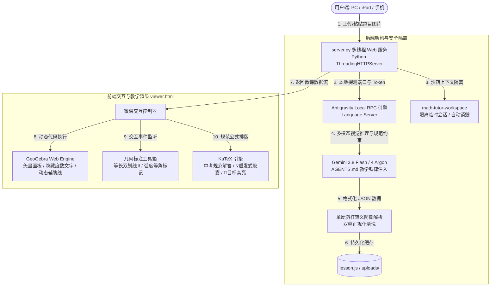

# 📐 Math Tutor - 初中几何交互微课生成器

> **基于 Antigravity 本地多模态大模型与 GeoGebra 交互画板的初中数学几何培优 AI 助教。**  
> 一键粘贴原题图片，全自动 1:1 复刻原图、启发式推导演绎、动态生成 GeoGebra 交互式板书与中考规范书写过程。

---

## 🌟 核心亮点

- 📸 **真题图片一秒解析**：支持剪贴板图片直接粘贴（`Cmd+V` / `Ctrl+V`）、拖拽上传或文件选择，秒级识别图形拓扑与题干条件。
- 📐 **1:1 原图复刻与动态板书**：严禁随意旋转或扭曲图形，自适应建立坐标系；通过 GeoGebra 纯代码指令渲染高质量矢量几何画板。
- 💡 **启发式辅助线思维引导（独创铁律）**：
  - 拒绝生硬下达作图指令！每个作辅助线的步骤行首自动注入翡翠绿 `【💡 辅助线是怎么想到的？】` 胶囊。
  - 讲透“**图中残缺特征 $\rightarrow$ 为什么需要补线 $\rightarrow$ 如何作辅助线**”的思维推导链路。
- 🔍 **经典解题套路精准识别**：
  - 遇到残缺直角与等腰特征时，明确点出**【一线三垂直（K字型全等）】**并讲明“知二补一”；
  - 识别沙漏全等、倍长中线、截长补短、手拉手、将军饮马等真模型；无辅助线常规顺推时则严禁生搬硬套。
- ✏️ **交互式几何标注工具栏**：
  - 画板右上角集成磨砂玻璃悬浮工具箱，支持鼠标点击线段一键打上初中数学规范的**等长双划线刻度（`||`）**与**高亮等角**，交互沉浸感拉满。
- 🔑 **100% 免 API Key & 顶级模型直连**：
  - 动态对接本机运行的 Antigravity Local Language Server RPC，直通 Gemini 3.8 Flash / Gemini 4 Argon 等高阶模型。
  - 零公网 Key 配置、零额外成本、零外部额度限制。
- 📱 **多线程高并发 & 局域网全设备共享**：
  - 后端绑定 `0.0.0.0:8765`，自动识别过滤代理网卡并打印局域网真实 IP；
  - 同一 Wi-Fi 下的 iPad、手机、安卓平板或家庭其他电脑即开即用。

---

## 🏗️ 技术架构

系统采用轻量化、前后端分离但零额外外部依赖的现代全栈架构设计：



### 1. 前端技术机构 (`viewer.html`)
- **交互画板引擎**：集成 GeoGebra Web API (`deployggb.js`)，支持通过 JavaScript 动态执行 GGB 几何脚本。内置脚本拦截器隐藏重叠杂乱的角度文字，只保留几何图形、直角符号与辅助虚线。
- **排版与公式系统**：集成 KaTeX 高速数学公式渲染库，支持中考标准格式排版。
- **视觉呈现系统**：采用 Glassmorphism（磨砂玻璃质感）悬浮设计，自动识别并分行呈现天蓝色因果推导（`① ② ③`）、翡翠绿辅助线引导卡片与金色高亮目标胶囊（`🎯`）。
- **几何标注交互模块**：监听 GeoGebra 对象的点击拾取事件，实现用户自主标记等长边（绘制平行刻度）与等角弧度，并支持一键清空重置。

### 2. 后端技术机构 (`server.py`)
- **零依赖原生服务**：仅使用 Python 3 标准库（`http.server.ThreadingHTTPServer`、`subprocess`、`urllib`、`base64`），无需运行 `pip install` 任何第三方包。
- **Antigravity RPC 嗅探器**：自动扫描操作系统进程表，获取运行中的 `language_server` 本地端口和鉴权 CSRF Token，使用 `StartCascade` 会话通道发起多模态请求。
- **严格工作区沙箱隔离**：每次推导创建临时隔离会话并在完成后主动垃圾回收，保证数据与文件只落在 `math-tutor-workspace` 内，杜绝工作区污染。
- **单反斜杠防御与清洗**：内置针对 LaTeX 转义字符（如 `\triangle`, `\text`, `\because`, `\frac`）的自动检测与修复算法，避免被 JSON 引擎误解码为控制字符。

---

## 🚀 本地快速启动

### 1. 前置准备
- **操作系统**：macOS / Linux / Windows
- **Python 版本**：Python 3.8 及以上（自带标准库即可）
- **客户端环境**：本机已打开并登录 **Antigravity**（保持后台运行，以提供本地推理引擎支持）

### 2. 启动服务

进入项目根目录，直接运行：

```bash
python3 server.py
```

终端将打印如下启动信息：

```text
============================================================
 🚀 数学几何微课全自动 Web App 服务已启动（支持局域网共享）！
 🔒 严格沙箱工作区: /Users/dean/Documents/math-tutor-workspace
 ✅ 已自动连接 Antigravity Pro 引擎 (用户: xxx, 端口: xxxxx)
 💻 本机访问地址:   http://127.0.0.1:8765/viewer.html
 📱 局域网访问地址: http://192.168.x.x:8765/viewer.html  (或直接 http://192.168.x.x:8765)
============================================================
```

### 3. 访问 Web 界面

- **本机电脑访问**：在浏览器打开 [http://127.0.0.1:8765](http://127.0.0.1:8765)
- **iPad / 手机 / 局域网其他设备**：确保连接同一 Wi-Fi，打开终端提示的局域网地址（如 `http://192.168.1.100:8765`）即可直接平板触控教学！

---

## 📖 使用指南

1. **题目输入**：
   - 使用微信、QQ 或系统截图工具截取几何题目。
   - 切换到浏览器页面，直接按下 **`Cmd + V`**（Mac）或 **`Ctrl + V`**（Windows）粘贴。
   - 或点击上传虚线区域选择图片文件 / 直接拖拽图片进页面。
2. **个性化微调（可选）**：
   - 可以在模型下拉框中切换模型档位（默认推荐 `Gemini 3.8 Flash`）。
   - 在输入框填写讲题侧重点（例如：“*重点讲解第(2)问*”、“*面向基础较弱学生，多写推导细节*”）。
3. **点击「开始全自动生成微课」**：
   - 稍候数秒，画板中央显示 Loading 动画，后台自动完成看图、建系、分步板书推导与代码生成。
4. **分步演练与交互学习**：
   - **查看板书**：点击「第 1 步」、「第 2 步」按钮，观察原图蓝线与动态生长的亮黄辅助线。
   - **标注等长线**：点击画板右上角 `[ |=| 标记等长边 ]`，依次点击图形中的两条线段，即可自动在画板打上双划线刻度标记。
   - **中考解答规范**：点击右侧下方「查看完整中考书写规范」展开整洁规范的 LaTeX 解答步骤。

---

## 📂 项目结构

```text
math-tutor-workspace/
├── README.md               # 项目主说明文档（醒目介绍、架构说明、启动指南）
├── server.py               # 后端核心服务（Antigravity 本地 RPC 调度、沙箱隔离、多线程 HTTP）
├── viewer.html             # 前端单页 Web App（GeoGebra 引擎、KaTeX 渲染、标注工具栏）
├── lesson.js               # 当前题目的完整结构化微课数据缓存（支持离线浏览）
├── uploads/                # 历史上传题目图片的本地存储备份目录
├── docs/
│   └── HANDOFF.md          # 会话上下文恢复与状态交接文档
├── .antigravity/
│   └── AGENTS.md           # 题目解析与教学板书生成的顶级准则与提示词约束
├── .agent/workflows/       # 预置工作流命令定义（/save, /resume 等）
└── .gitignore              # Git 忽略文件配置
```

---

## ❓ 常见问题 (FAQ)

### Q1: 提示「未检测到 Antigravity 客户端」？
- **解答**：本项目无需配置任何 API Key，但依赖本地运行的 Antigravity 引擎提供多模态视觉推理能力。请确认 Antigravity 应用程序已在当前电脑打开并处于登录状态。

### Q2: 局域网内手机或 iPad 打不开页面？
- **解答**：
  1. 确认手机/iPad 与主机处于同一个 Wi-Fi 网络下；
  2. 检查电脑系统防火墙是否阻止了 `8765` 端口的入站连接；
  3. `server.py` 已自动过滤 VPN/代理产生的虚拟网卡（如 198.18.x.x），终端打印的 `http://192.168.x.x:8765` 即为真实局域网 IP。

### Q3: 为什么画板上的角度没有密密麻麻的度数数字？
- **解答**：这属于系统特意设计的教学视觉优化。几何证明题中大面积标注度数会导致文字层叠打架；系统自动过滤了度数文本，只保留符合中考阅卷审美的圆弧与垂直直角方框。
